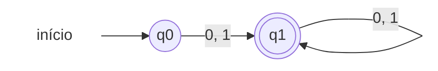
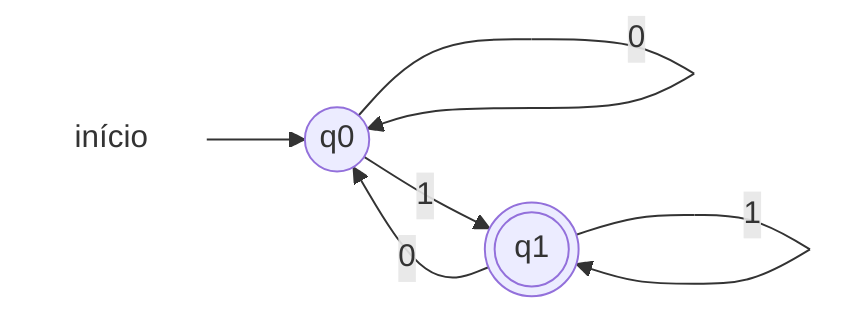
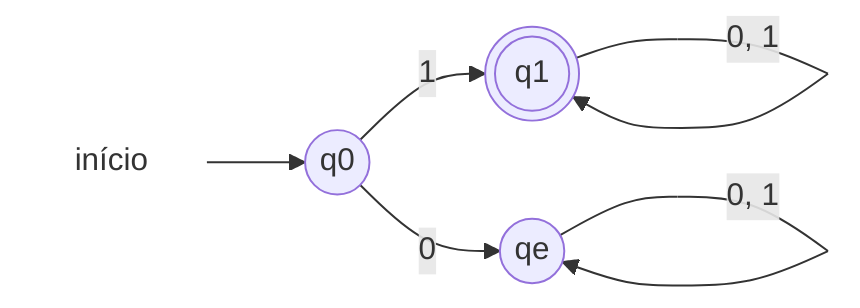
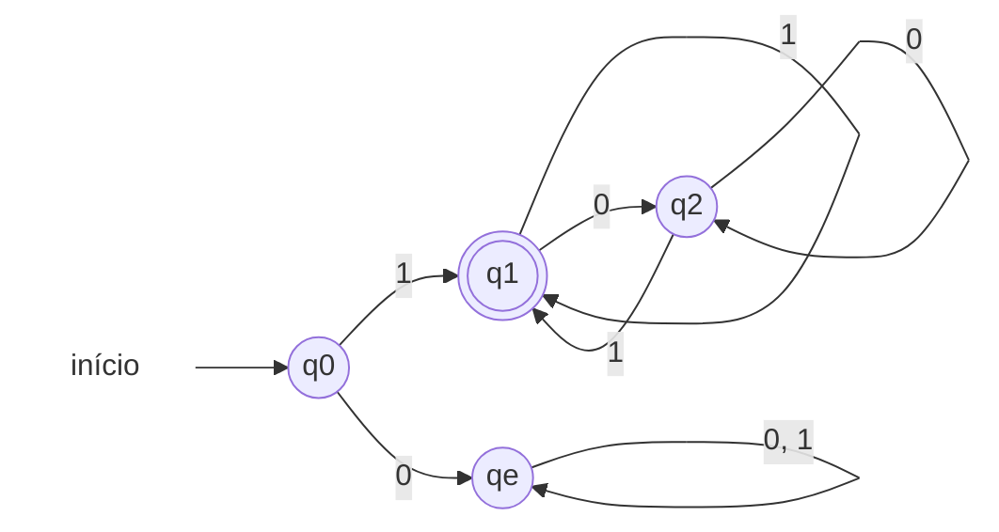

# Exercício: Autômatos Finitos para Linguagens Binárias

Soluções modeladas como **Autômatos Finitos Determinísticos (AFD)** sobre o alfabeto $\Sigma = \{0, 1\}$.

### Notação dos Diagramas
- **Círculo simples `((q))`**: estado não-final / transitório.
- **Círculo duplo `(((q)))`**: estado de aceitação / final.
- **Seta inicial**: indica o estado inicial.

---

## a) Números binários

Considera qualquer sequência não vazia de dígitos binários ($\Sigma^+$).

* **Expressão Regular:** `(0 | 1)+`
* **Lógica:** Consome pelo menos um bit para validar o número e permanece em estado de aceitação para qualquer bit subsequente.

### Tabela de Transições

| Estado | Entrada `0` | Entrada `1` | É final? |
| :--- | :---: | :---: | :---: |
| $\rightarrow q_0$ | $q_1$ | $q_1$ | Não |
| $*q_1$ | $q_1$ | $q_1$ | **Sim** |

---

## b) Números binários ímpares

Um número binário é ímpar se, e somente se, o seu último dígito for `1`.

* **Expressão Regular:** `(0 | 1)* 1`
* **Lógica:** Alterna entre estado par ($q_0$) e ímpar ($q_1$) de acordo com o último bit lido. O estado de aceitação é o que representa terminação em `1`.

### Tabela de Transições

| Estado | Entrada `0` | Entrada `1` | É final? |
| :--- | :---: | :---: | :---: |
| $\rightarrow q_0$ | $q_0$ | $q_1$ | Não |
| $*q_1$ | $q_0$ | $q_1$ | **Sim** |

---

## c) Números binários iniciados por um

O primeiro dígito deve ser obrigatoriamente `1`. Se iniciar com `0`, vai para o estado de erro/poço ($q_e$).

* **Expressão Regular:** `1 (0 | 1)*`
* **Lógica:** A partir do estado inicial, a leitura de `1` leva ao estado final $q_1$, aceitando qualquer sequência seguinte. A leitura inicial de `0` leva a um estado poço sem saída.

### Tabela de Transições

| Estado | Entrada `0` | Entrada `1` | É final? |
| :--- | :---: | :---: | :---: |
| $\rightarrow q_0$ | $q_e$ | $q_1$ | Não |
| $*q_1$ | $q_1$ | $q_1$ | **Sim** |
| $q_e$ | $q_e$ | $q_e$ | Não (Poço) |

---

## d) Números binários iniciados por um e ímpares

Devem começar com `1` e terminar com `1` (ex.: `1`, `11`, `101`, `111`, `1001`).

* **Expressão Regular:** `1 | 1(0 | 1)* 1` (ou `1((0 | 1)* 1)?`)
* **Estados:**
  * $q_0$: inicial (nenhum símbolo lido).
  * $q_1$: aceitação (iniciou com `1` e o último dígito lido foi `1`).
  * $q_2$: não-final (iniciou com `1`, mas o último dígito lido foi `0` — número par).
  * $q_e$: erro / poço (iniciou com `0`).

### Tabela de Transições

| Estado | Entrada `0` | Entrada `1` | É final? |
| :--- | :---: | :---: | :---: |
| $\rightarrow q_0$ | $q_e$ | $q_1$ | Não |
| $*q_1$ | $q_2$ | $q_1$ | **Sim** |
| $q_2$ | $q_2$ | $q_1$ | Não |
| $q_e$ | $q_e$ | $q_e$ | Não (Poço) |

