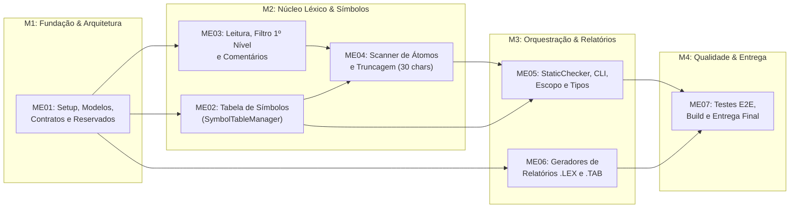

# Planejamento de Desenvolvimento — Static Checker (`BigHole2026-2`)

Este diretório centraliza o mapeamento completo de desenvolvimento do **Static Checker** da linguagem **BigHole2026-2** (Entrega Final — Etapa 7 `LEX`), organizado no formato de **Milestones**, **Macroentregas (Parent Issues)** e **Sub-Issues** para gestão direta no **GitHub Projects**.

O planejamento deriva da concepção arquitetural definida na [Etapa 1 — PROJ](../Etapa1_Proj/EntregaEtapa1PROJ.md) e dos requisitos formais da especificação oficial [Projeto2026-2 vSN1.md](../Projeto2026-2%20vSN1.md).

---

## 1. Visão Geral do Projeto

| Atributo | Definição |
| :--- | :--- |
| **Disciplina** | Compiladores (2026.2) |
| **Projeto** | Static Checker da linguagem `BigHole2026-2` |
| **Stack Técnica** | Java (JDK 27) · IntelliJ IDEA 2026.2.3 |
| **Equipe** | `EQ04` *(verificar padronização com o professor — ver Seção 6)* |
| **Integrantes** | Leonardo Santos Magalhães · Marcos Paulo Teles de Menezes Filho · Rafael Guerra de Oliveira · Rian Albert dos Santos Dultra |
| **Entrada** | Arquivo texto ASCII com extensão `.262` (informado sem extensão na chamada) |
| **Saídas Obrigatórias** | `<nome>.LEX` (Análise Léxica) e `<nome>.TAB` (Tabela de Símbolos), gerados na mesma pasta do arquivo fonte |

---

## 2. Mapa de Milestones (Marcos de Desenvolvimento)

O desenvolvimento é dividido em **4 Milestones sequenciais**, estruturadas para destravar trabalho paralelo entre os 4 integrantes da equipe assim que os contratos entre módulos forem fechados na Milestone 1.

### Resumo das Milestones

| Milestone | Objetivo Principal | Macroentregas | Critério de Conclusão (Exit Criteria) |
| :--- | :--- | :--- | :--- |
| **M1 — Fundação & Arquitetura** | Criar esqueleto Java 27, modelos de dados, interfaces entre módulos e tabela imutável de reservados (`A01`–`A26`, `B01`–`B22`). | [ME01](./ME01-setup-arquitetura-contratos.md) | Projeto compila no IntelliJ/CLI; contratos `ILexicalAnalyzer`, `ISymbolTableManager` e `ReservedTable` aprovados pela equipe. |
| **M2 — Núcleo Léxico & Tabela de Símbolos** | Implementar isoladamente o armazenamento de símbolos, o filtro de 1º nível, comentários e o reconhecimento de todos os átomos (`A`, `B`, `C`) com truncagem segura em 30 caracteres. | [ME02](./ME02-tabela-de-simbolos.md), [ME03](./ME03-leitura-filtro-comentarios.md), [ME04](./ME04-analisador-lexico-atomos.md) | `SymbolTableManager` e `LexicalAnalyzer` passando em testes unitários cobrindo todos os padrões léxicos do Apêndice C e regras de truncagem/filtro. |
| **M3 — Orquestração, Escopo & Relatórios** | Conectar os módulos no programa principal (`StaticChecker`), resolver entrada `.262`, controlar contexto/escopo (`C01`/`C02`/`C03`), inferir `TipoSimb` e gravar `.LEX` e `.TAB`. | [ME05](./ME05-orquestrador-cli-escopo.md), [ME06](./ME06-geracao-relatorios.md) | Execução ponta a ponta com `Teste.262` gerando `Teste.LEX` e `Teste.TAB` na mesma pasta do fonte, fiéis ao layout da especificação. |
| **M4 — Validação, Testes & Entrega Final** | Garantir robustez frente a casos de borda, validar `TC01`–`TC06`, empacotar executável e montar documentação/pacote da Etapa 7 (`LEX`). | [ME07](./ME07-testes-empacotamento-entrega.md) | 100% da suíte de testes aprovada, artefato executável testado em máquina limpa e pacote `EQ04LEX` pronto para submissão. |

---

## 3. Catálogo de Macroentregas e Sub-Issues

Cada arquivo listado abaixo está formatado em **GitHub Flavored Markdown** pronto para ser criado como **Issue Pai (Macroentrega)** no GitHub, contendo o detalhamento técnico e os critérios de aceite de cada **Sub-Issue** filha.

| ID | Macroentrega | Milestone | Sub-Issues | Dependências | Labels Sugeridas |
| :---: | :--- | :---: | :---: | :---: | :--- |
| **ME01** | [Setup do Projeto, Arquitetura Base e Contratos](./ME01-setup-arquitetura-contratos.md) | `M1` | 4 | Nenhuma | `macroentrega`, `arquitetura`, `setup`, `prioridade:alta` |
| **ME02** | [Gerenciador da Tabela de Símbolos (`SymbolTableManager`)](./ME02-tabela-de-simbolos.md) | `M2` | 4 | `ME01` | `macroentrega`, `tabela-simbolos`, `core` |
| **ME03** | [Leitura de Entrada, Filtro de 1º Nível e Comentários](./ME03-leitura-filtro-comentarios.md) | `M2` | 4 | `ME01` | `macroentrega`, `lexico`, `core`, `prioridade:alta` |
| **ME04** | [Analisador Léxico — Reconhecimento de Átomos e Truncagem](./ME04-analisador-lexico-atomos.md) | `M2` | 5 | `ME01`, `ME02`, `ME03` | `macroentrega`, `lexico`, `core`, `prioridade:alta` |
| **ME05** | [Orquestrador Principal (`StaticChecker`), CLI e Escopo Contextual](./ME05-orquestrador-cli-escopo.md) | `M3` | 4 | `ME02`, `ME04` | `macroentrega`, `sintatico-escopo`, `cli` |
| **ME06** | [Geradores de Relatórios de Saída (`.LEX` e `.TAB`)](./ME06-geracao-relatorios.md) | `M3` | 3 | `ME01` | `macroentrega`, `relatorios`, `io` |
| **ME07** | [Validação, Testes End-to-End, Empacotamento e Entrega (`LEX`)](./ME07-testes-empacotamento-entrega.md) | `M4` | 4 | `ME05`, `ME06` | `macroentrega`, `testes`, `entrega`, `documentacao` |

**Total mapeado:** **7 Macroentregas** · **28 Sub-Issues**.

---

## 4. Organização da Equipe e Paralelização das Frentes

Como a equipe conta com **4 integrantes** e a especificação reforça que **todos devem dominar integralmente o projeto**, recomenda-se trabalhar por frentes paralelas desacopladas pelas interfaces da `ME01`, com **Code Review cruzado obrigatório** em todos os Pull Requests.

### Sugestão de Divisão de Frentes por Fase

| Fase | Frente A (Dev 1) | Frente B (Dev 2) | Frente C (Dev 3) | Frente D (Dev 4) |
| :--- | :--- | :--- | :--- | :--- |
| **Sprint 1 (`M1`)** | `ME01.1` Setup IntelliJ/JDK 27 | `ME01.2` Modelos de dados | `ME01.3` Interfaces/contratos | `ME01.4` `ReservedTable` (`A`/`B`) |
| **Sprint 2 (`M2` — Parte 1)** | `ME02.1`–`ME02.4` Tabela de Símbolos completa | `ME03.1`–`ME03.2` `SourceReader` + Filtro 1º Nível | `ME03.3`–`ME03.4` Espaços + Comentários | `ME06.1`–`ME06.3` Geradores `.LEX` e `.TAB` *(antecipável via mocks!)* |
| **Sprint 3 (`M2` — Parte 2)** | `ME04.1` Palavras reservadas e identificadores | `ME04.2` Operadores e símbolos (`B01`–`B22`) | `ME04.3` Constantes numéricas + truncagem | `ME04.4`–`ME04.5` Strings/Chars + Integração TAB |
| **Sprint 4 (`M3`)** | `ME05.1` CLI e resolução `.262` | `ME05.2` Máquina de estados de Escopo | `ME05.3` Captura de `TipoSimb` | `ME05.4` Loop *syntax-driven* + Integração `.LEX`/`.TAB` |
| **Sprint 5 (`M4`)** | `ME07.1` Suíte `TC01`–`TC06` + `Teste.262` | `ME07.2` Testes de estresse e borda | `ME07.3` Auditoria de conformidade dos relatórios | `ME07.4` Build executável + Pacote `EQ04LEX` |

> [!TIP]
> Observe que **`ME06` (Relatórios `.LEX` e `.TAB`)** depende apenas dos modelos (`Token`, `SymbolEntry`) definidos na `ME01`. Portanto, um integrante pode desenvolvê-la e testá-la com dados *mockados* já durante a Milestone 2, reduzindo drasticamente o gargalo da reta final!

---

## 5. Como Configurar no GitHub Projects

### 5.1. Estrutura no Repositório
1. **Milestones:** Crie 4 Milestones no GitHub (`M1: Fundação & Arquitetura`, `M2: Núcleo Léxico & Símbolos`, `M3: Orquestração & Relatórios`, `M4: Validação & Entrega Final`).
2. **Labels:** Crie as labels sugeridas abaixo para filtrar rapidamente o quadro:
   - **Tipo:** `macroentrega`, `sub-issue`, `bug`, `testes`, `documentacao`
   - **Módulo:** `arquitetura`, `setup`, `lexico`, `tabela-simbolos`, `sintatico-escopo`, `cli`, `relatorios`
   - **Prioridade:** `prioridade:alta`, `prioridade:media`, `prioridade:baixa`
3. **Issues Pai e Sub-Issues:**
   - Para cada arquivo `ME0X-*.md`, crie uma Issue no GitHub vinculada à respectiva Milestone e com a label `macroentrega`.
   - Utilize o recurso nativo de **Sub-issues** do GitHub para criar cada item `ME0X.Y` como Sub-issue filha da Macroentrega correspondente.
4. **Board no GitHub Projects (Kanban):**
   - Colunas sugeridas: `Backlog` → `Ready` → `In Progress` → `In Review` → `Done`.
   - Agrupamento recomendado: crie uma View em tabela agrupada por **Milestone** e outra View em Board filtrada por **Sub-Issues** da Milestone ativa.

### 5.2. Fluxo de Branches e Pull Requests
- Branch principal protegida: `main`.
- Convenção de branches por Sub-Issue: `feat/ME0X-Y-descricao-curta` (ex.: `feat/ME03-2-filtro-primeiro-nivel`).
- Todo PR deve referenciar a Sub-Issue (`Closes #<num>`) e receber **pelo menos 1 aprovação** de outro integrante da equipe antes do merge.

---

## 6. Alinhamentos Críticos (`Etapa1_Proj` vs. Especificação Oficial)

Durante o cruzamento entre a concepção inicial ([EntregaEtapa1PROJ.md](../Etapa1_Proj/EntregaEtapa1PROJ.md)) e o documento oficial ([Projeto2026-2 vSN1.md](../Projeto2026-2%20vSN1.md)), foram identificados **6 pontos de atenção** já incorporados às Sub-Issues para evitar retrabalho:

1. **Identificação da Equipe nos Relatórios:** A `Etapa1_Proj` citava código `E01` e e-mails antigos, enquanto as entregas posteriores (`TBNF`, `TWIR`, `SIMP`) usam `EQ04` / `E04` e os e-mails institucionais atualizados. Centralizar esses dados em `EquipeConfig` (`ME01.2`) e confirmar o código oficial (`EQ04` ou `E04`) na planilha do Classroom.
2. **Underline (`_`) em Identificadores:** No Apêndice C da especificação oficial, `<variable>` (`C01`) aceita `_` tanto no início quanto no meio (`<letra> | _`), enquanto `<programName>` (`C03`) e `<functionName>` (`C02`) aceitam **apenas letras e dígitos** (iniciando com letra). Isso está coberto em `ME04.1`.
3. **Constantes na Tabela de Símbolos:** O Apêndice A.3 e a seção *Tabela de Símbolos* classificam todos os átomos `C01`–`C07` (`variable`, `functionName`, `programName`, `stringConst`, `charConst`, `intConst`, `realConst`) na classe de identificadores armazenados na Tabela de Símbolos com seus respectivos `TipoSimb`. Coberto em `ME02` e `ME04.5`.
4. **Tipos Semânticos de Vetores (`TipoSimb`):** Além dos 6 tipos escalares (`FP`, `IN`, `ST`, `CH`, `BL`, `VD`), a especificação exige os **5 tipos de array**: `AF`, `AI`, `AS`, `AC`, `AB`. Coberto em `ME01.2`, `ME02.3` e `ME05.3`.
5. **Truncagem Coerente em 30 Caracteres:** Para `realConst` (`C07`), truncar em 30 caracteres não pode deixar um lexema malformado (ex.: terminando em `.`, `E`, `E+` ou `E-`). Para `stringConst` (`C04`), as aspas de abertura e fechamento contam nos 30 caracteres e deve-se forçar o fechamento `"` na posição 30. Coberto em `ME04.3` e `ME04.4`.
6. **Chamada do Arquivo Fonte:** A especificação exige que o usuário informe o nome do arquivo **sem a extensão `.262`** (tanto nome simples no diretório atual quanto caminho completo), mas também cita solicitação ao usuário. Em `ME05.1` o `StaticChecker` suportará argumento via CLI e fallback interativo via console.

---

## 7. Definition of Done (DoD) Global

Uma Sub-Issue só é considerada **Done** quando:
- [ ] O código está implementado em Java 27 seguindo os contratos definidos na `ME01` e sem dependências externas desnecessárias.
- [ ] Possui testes unitários/de integração cobrindo o caminho feliz e os casos de borda descritos na issue.
- [ ] Todos os testes existentes continuam passando após a integração.
- [ ] O código foi revisado por pelo menos um colega da equipe via Pull Request.
- [ ] Todos os integrantes envolvidos compreendem a implementação (aderência total às regras da disciplina).
