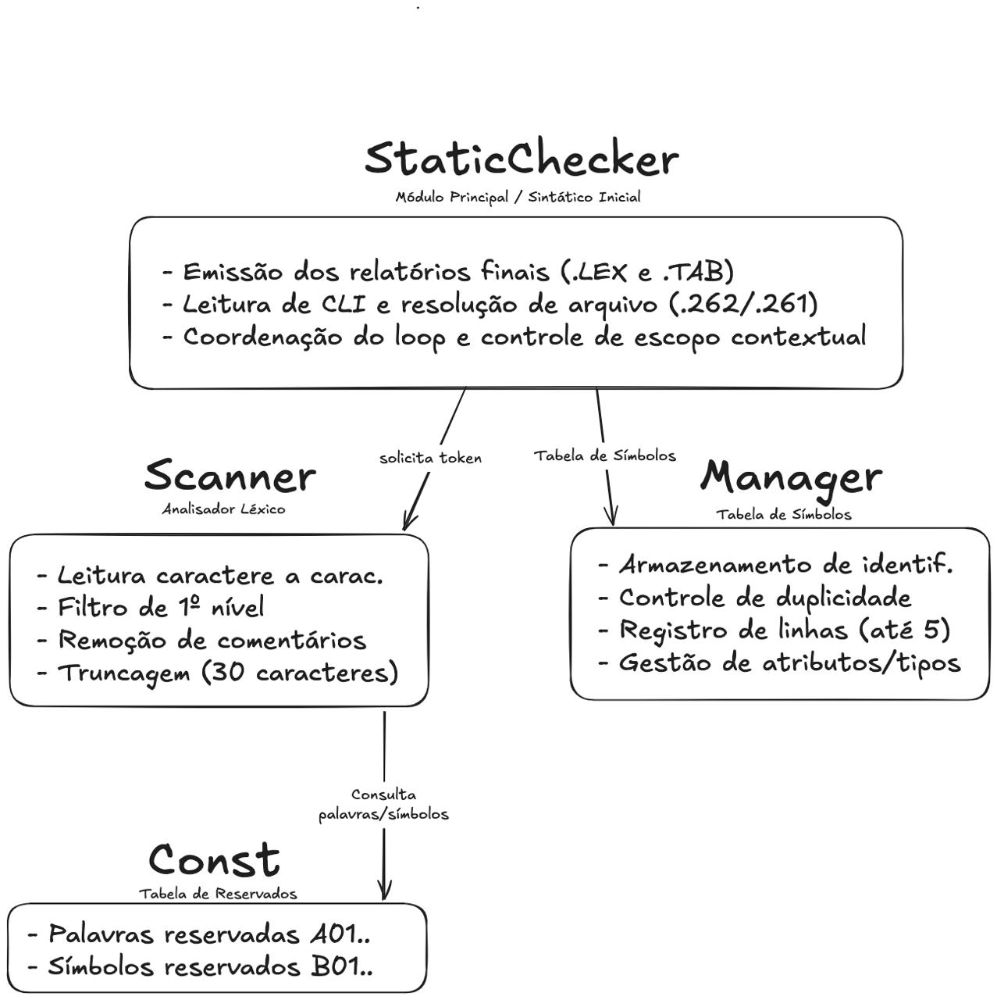
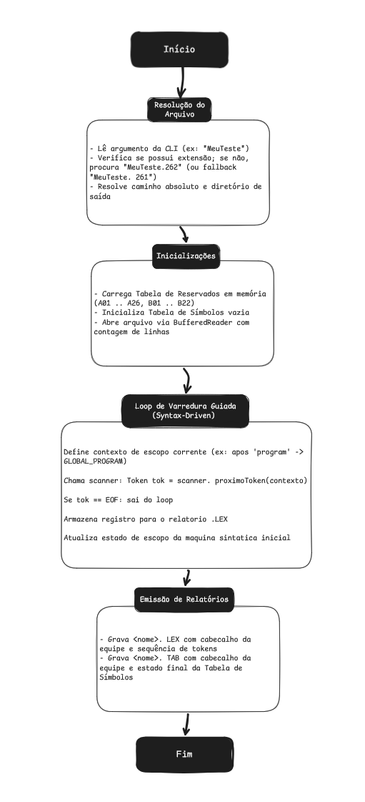
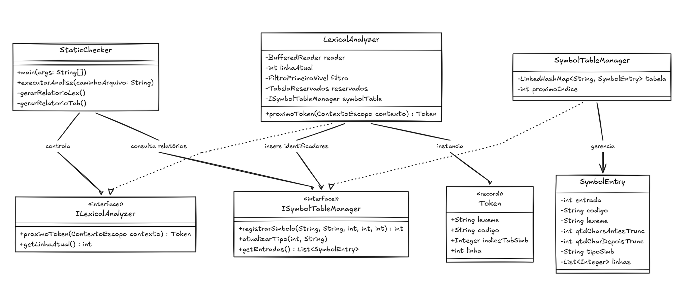

# Projeto Conceitual do Static Checker — BigHole2026-2
**Etapa 1: PROJ — Especificação Arquitetural e de Implementação**

---

### Identificação da Equipe
- **Disciplina:** Compiladores (2026.2)
- **Período de Execução:** 07/11/2026 a 01/12/2026 | **Data da Entrega PROJ:** 09/11/2026
- **Ambiente de Desenvolvimento:** Java (JDK 27), IntelliJ IDEA 2026.2.3
- **Componentes da Equipe:**
  - Leonardo Magalhães — `leonardo.magalhaes@aln.senaicimatec.edu.br` - 71981379640
  - Marcos Paulo — `marcos.paulo@aln.senaicimatec.edu.br` - 71992782161
  - Rafael Guerra — `rafael.guerra@aln.senaicimatec.edu.br` - 75991140115
  - Rian Dultra — `rian.dultra@aln.senaicimatec.edu.br` - 71987981802

---

## 1. Arquitetura dos Módulos e Responsabilidades

O **Static Checker** da linguagem BigHole2026-2 é estruturado em três módulos cooperantes com separação estrita de responsabilidades:



### 1.1. Módulo Inicial do Analisador Sintático (`StaticChecker` / Programa Principal)
- **Coordenação do Ciclo de Vida:** Recebe o argumento de linha de comando, localiza o arquivo fonte (`.262` ou `.261`), instancia os módulos auxiliares e dispara o processamento orientado a sintaxe (*syntax-driven*).
- **Controle de Escopo Contextual:** Identifica o contexto sintático em que o analisador léxico se encontra (declaração de programa, cabeçalho de função, bloco de variáveis ou comandos) para orientar a correta classificação de identificadores ambíguos na gramática (`programName` vs `functionName` vs `variable`).
- **Geração de Saídas:** Ao final da varredura, orquestra a formatação e escrita dos arquivos `<nome>.LEX` e `<nome>.TAB` na mesma pasta do código-fonte.

### 1.2. Analisador Léxico (`LexicalAnalyzer`)
- **Varredura e Filtragem:** Lê o fluxo de caracteres de entrada, aplica o **filtro de primeiro nível** (ignora caracteres inválidos da linguagem sem tratá-los como delimitadores) e descarta espaços redundantes e comentários (linha `//` e bloco `/* ... */`).
- **Formação de Átomos (Tokens):** Reconhece palavras reservadas, operadores, delimitadores, constantes e identificadores segundo as regras léxicas da linguagem.
- **Normalização e Truncagem:** Converte todos os lexemas internamente para maiúsculas (*case-insensitive*) e impõe o limite máximo de 30 caracteres válidos, preservando o tamanho original antes da truncagem para registro na tabela de símbolos.
- **Comunicação com a Tabela de Símbolos:** Ao identificar um átomo da classe C (identificador ou constante literal a ser catalogada), interage com o gerenciador da Tabela de Símbolos para obter ou registrar o índice correspondente.

### 1.3. Gerenciador da Tabela de Símbolos (`SymbolTableManager`)
- **Unicidade de Identificadores:** Mantém uma entrada única para cada identificador (`variable`, `functionName`, `programName`) e constante cadastrada.
- **Rastreamento de Ocorrências:** Registra as primeiras 5 linhas em que o símbolo aparece no texto-fonte.
- **Gerenciamento de Metadados:** Armazena código do átomo (`C01` a `C07`), lexema truncado, tamanhos pré e pós-truncagem e o tipo semântico associado (`FP`, `IN`, `ST`, etc.), gerando o espelho exato para o relatório `.TAB`.

---

## 2. Interfaces entre Módulos e Contratos de Comunicação

O projeto adota Java 27 com tipagem estática rigorosa, records imutáveis para transferência de dados e tratamento explícito de exceções de I/O.

### 2.1. Modelos de Dados de Intercâmbio

```java
package br.ucsal.bighole.model;

/**
 * Representa um token gerado pelo Analisador Léxico.
 */
public record Token(
    String lexeme,          // Lexema normalizado (caixa alta, máx 30 caracteres)
    String codigo,          // Ex.: "A01", "B04", "C01"
    Integer indiceTabSimb,  // Índice 1-based na Tabela de Símbolos (ou null se não aplicável)
    int linha               // Linha inicial onde o token foi encontrado
) {
    public String getIndiceFormatado() {
        return indiceTabSimb != null ? String.valueOf(indiceTabSimb) : "-";
    }
}
```

```java
package br.ucsal.bighole.model;

/**
 * Contexto de escopo informado pelo controlador sintático ao léxico.
 */
public enum ContextoEscopo {
    GLOBAL_PROGRAM,         // Esperando programName logo após token 'program'
    DECLARACAO_FUNCAO,      // Esperando functionName logo após 'funcType <tipo> :'
    CORPO_INSTRUCOES        // Identificadores comuns (variable)
}
```

### 2.2. Contrato do Analisador Léxico (`ILexicalAnalyzer`)

```java
package br.ucsal.bighole.lexical;

import br.ucsal.bighole.model.Token;
import br.ucsal.bighole.model.ContextoEscopo;

public interface ILexicalAnalyzer {
    /**
     * Retorna o próximo token do arquivo fonte.
     * @param contexto Contexto sintático corrente para desambiguação de identificadores.
     * @return Próximo Token válido, ou null quando atingir o final do arquivo (EOF).
     */
    Token proximoToken(ContextoEscopo contexto);

    /**
     * Informa a linha corrente do cursor de leitura no arquivo fonte.
     */
    int getLinhaAtual();
}
```

### 2.3. Contrato do Gerenciador da Tabela de Símbolos (`ISymbolTableManager`)

```java
package br.ucsal.bighole.symboltable;

import java.util.List;

public interface ISymbolTableManager {
    /**
     * Insere ou atualiza um identificador na tabela de símbolos.
     * Se o lexema já existir, apenas adiciona a linha de ocorrência (até o teto de 5).
     *
     * @param lexemeTruncado     Lexema em caixa alta, limitado a 30 caracteres.
     * @param codigo             Código do átomo (ex.: "C01", "C02", "C03").
     * @param tamAntesTrunc      Quantidade de caracteres válidos antes da truncagem.
     * @param tamDepoisTrunc     Quantidade de caracteres válidos pós-truncagem (máx 30).
     * @param linha              Linha onde a ocorrência foi detectada.
     * @return Índice 1-based atribuído ao símbolo.
     */
    int registrarSimbolo(
        String lexemeTruncado,
        String codigo,
        int tamAntesTrunc,
        int tamDepoisTrunc,
        int linha
    );

    /**
     * Associa tipo semântico a uma entrada existente (ex: "IN", "FP", "ST", "BL").
     */
    void atualizarTipo(int indice, String tipoSimb);

    /**
     * Retorna todas as entradas para a montagem do relatório .TAB.
     */
    List<SymbolEntry> getEntradas();
}
```

### 2.4. Convenções de Erro e Tratamento
1. **Arquivo não encontrado:** O programa exibe mensagem no console indicando ausência do arquivo e encerra com código `1`.
2. **Caracteres Inválidos:** Não disparam exceções nem encerram a execução. O filtro de 1º nível descarta silenciosamente o caractere sem interromper a montagem do lexema corrente.
3. **Comentários de bloco não fechados:** O scanner consome até o fim do arquivo (EOF) de forma tolerante, fechando o escopo sem interromper abruptamente o compilador.
4. **Strings com quebra de linha sem fechamento:** O léxico fecha a string na posição limite (ou quebra de linha) e avisa o controlador sintático.

---

## 3. Estruturas de Dados Fundamentais

### 3.1. Tabela de Palavras e Símbolos Reservados (`ReservedTable`)
Implementada como mapas imutáveis em memória (`Map<String, String>`), garantindo busca em tempo constante $O(1)$.

- **Palavras Reservadas (A01 a A26):**
  Todas as chaves são mantidas em maiúsculas para comparação imediata após a normalização do lexema:

| Lexema (Chave) | Código | Lexema (Chave) | Código | Lexema (Chave) | Código |
|:---|:---:|:---|:---:|:---|:---:|
| `BOOLEAN` | A01 | `ENDPROGRAM` | A10 | `REAL` | A20 |
| `BREAK` | A02 | `ENDWHILE` | A11 | `RETURN` | A21 |
| `CHARACTER` | A03 | `FALSE` | A12 | `STRING` | A22 |
| `DECLARATIONS` | A04 | `FUNCTIONS` | A13 | `TRUE` | A23 |
| `ELSE` | A05 | `FUNCTYPE` | A14 | `VARTYPE` | A24 |
| `ENDDECLARATIONS` | A06 | `IF` | A15 | `VOID` | A25 |
| `ENDFUNCTION` | A07 | `INTEGER` | A16 | `WHILE` | A26 |
| `ENDFUNCTIONS` | A08 | `PARAMTYPE` | A17 | | |
| `ENDIF` | A09 | `PRINT` | A18 | | |
| | | `PROGRAM` | A19 | | |

- **Símbolos e Operadores Reservados (B01 a B22):**

| Símbolo | Descrição | Código | Símbolo | Descrição | Código |
|:---:|:---|:---:|:---:|:---|:---:|
| `;` | Ponto e vírgula | B01 | `+` | Adição | B12 |
| `,` | Vírgula | B02 | `-` | Subtração | B13 |
| `:` | Dois pontos | B03 | `*` | Multiplicação | B14 |
| `:=` | Atribuição | B04 | `/` | Divisão | B15 |
| `?` | Interrogação | B05 | `%` | Módulo | B16 |
| `(` | Abre parênteses | B06 | `==` | Igualdade | B17 |
| `)` | Fecha parênteses | B07 | `!=` | Diferença | B18 |
| `[` | Abre colchetes | B08 | `#` | Diferença (alias) | B18 |
| `]` | Fecha colchetes | B09 | `<` | Menor | B19 |
| `{` | Abre chaves | B10 | `<=` | Menor ou igual | B20 |
| `}` | Fecha chaves | B11 | `>` | Maior | B21 |
| | | | `>=` | Maior ou igual | B22 |

### 3.2. Estrutura da Entrada da Tabela de Símbolos (`SymbolEntry`)

```java
package br.ucsal.bighole.symboltable;

import java.util.ArrayList;
import java.util.List;

public class SymbolEntry {
    private final int entrada;              // Índice sequencial 1-based
    private final String codigo;            // Ex: "C01", "C02", "C03"
    private final String lexeme;            // Até 30 caracteres válidos em CAIXA ALTA
    private final int qtdCharsAntesTrunc;   // Contagem real de caracteres válidos
    private final int qtdCharDepoisTrunc;   // Contagem pós-truncagem (máx 30)
    private String tipoSimb;                // "IN", "FP", "ST", "CH", "BL", "VD" ou "-"
    private final List<Integer> linhas;     // Até as 5 primeiras linhas de ocorrência

    public SymbolEntry(int entrada, String codigo, String lexeme,
                       int qtdCharsAntesTrunc, int qtdCharDepoisTrunc, int primeiraLinha) {
        this.entrada = entrada;
        this.codigo = codigo;
        this.lexeme = lexeme;
        this.qtdCharsAntesTrunc = qtdCharsAntesTrunc;
        this.qtdCharDepoisTrunc = qtdCharDepoisTrunc;
        this.tipoSimb = "-";
        this.linhas = new ArrayList<>(5);
        this.linhas.add(primeiraLinha);
    }

    public void adicionarOcorrencia(int linha) {
        if (this.linhas.size() < 5) {
            this.linhas.add(linha);
        }
    }

    // Getters e formatação para o relatório .TAB
    public int getEntrada() { return entrada; }
    public String getCodigo() { return codigo; }
    public String getLexeme() { return lexeme; }
    public int getQtdCharsAntesTrunc() { return qtdCharsAntesTrunc; }
    public int getQtdCharDepoisTrunc() { return qtdCharDepoisTrunc; }
    public String getTipoSimb() { return tipoSimb; }
    public void setTipoSimb(String tipoSimb) { this.tipoSimb = tipoSimb; }
    public List<Integer> getLinhas() { return linhas; }
}
```

### 3.3. Políticas de Armazenamento e Atualização
- **Indexação Dupla:** O gerenciador mantém um `LinkedHashMap<String, SymbolEntry>`.
  - A chave é o lexema truncado em caixa alta, garantindo verificação em $O(1)$.
  - A ordem de inserção original é estritamente preservada para geração do relatório `.TAB`.
- **Política de Inserção de Ocorrência:**
  - Se o lexema **não existe**, instancia uma nova entrada, atribui o índice `tamanho + 1` e guarda a linha inicial.
  - Se o lexema **já existe**, recupera a entrada existente e acrescenta a linha à lista, respeitando o limite rígido de 5 ocorrências (linhas adicionais são ignoradas silenciosamente).
- **Classificação dos Códigos C:**
  - `C01`: `variable`
  - `C02`: `functionName`
  - `C03`: `programName`
  - `C04`: `stringConst`
  - `C05`: `charConst`
  - `C06`: `intConst`
  - `C07`: `realConst`

---

## 4. Fluxo de Execução do Programa Principal

O fluxo de processamento do compilador opera da seguinte forma:



### 4.1. Lógica de Controle de Escopo Contextual
Na gramática formal de BigHole2026-2, os identificadores `programName`, `functionName` e `variable` possuem definições léxicas que coincidem (iniciam com letra e contêm letras/dígitos). A diferenciação semântica entre `C01`, `C02` e `C03` é resolvida pelo controlador sintático através de uma máquina de estados simples:
- **Estado Inicial:** Inicia em `CORPO_INSTRUCOES`.
- **Transição para `C03` (`programName`):** Ao ler a palavra reservada `PROGRAM` (`A19`), o controlador altera o contexto para `GLOBAL_PROGRAM`. O próximo identificador lido será categorizado como `C03`. Logo em seguida, o contexto retorna para `CORPO_INSTRUCOES`.
- **Transição para `C02` (`functionName`):** Ao ler a sequência `FUNCTYPE` (`A14`) seguida pelo tipo e `:` (`B03`), o contexto muda para `DECLARACAO_FUNCAO`. O identificador seguinte recebe código `C02`.
- **Padrão `C01` (`variable`):** Qualquer outro identificador em seções de declarações ou comandos é categorizado como `C01`.

### 4.2. Formatação dos Relatórios de Saída

#### Cabeçalho Obrigatório (comum a ambos os arquivos)
```text
Código da Equipe: E01
Componentes:
Leonardo Magalhães; leonardo.magalhaes@aln.senaicimatec.edu.br; 71981379640
Marcos Paulo; marcos.paulo@aln.senaicimatec.edu.br; 71992782161
Rafael Guerra; rafael.guerra@aln.senaicimatec.edu.br; 75991140115
Rian Dultra; rian.dultra@aln.senaicimatec.edu.br; 71987981802
```

#### Formato do `.LEX`
```text
RELATÓRIO DA ANÁLISE LÉXICA.
Texto fonte analisado: Teste.262
Lexeme: VAR1, Código: C01, indiceTabSimb: 1, Linha: 1.
Lexeme: ;, Código: B01, indiceTabSimb: -, Linha: 4.
```

#### Formato do `.TAB`
```text
RELATÓRIO DA TABELA DE SÍMBOLOS.
Texto fonte analisado: Teste.262
Entrada: 1, Código: C01, Lexeme: VAR1,
QtdCharsAntesTrunc: 4, QtdCharDepoisTrunc: 4,
TipoSimb: -, Linhas: (1, 2, 2, 2, 3).
---------------------------------------------------------------
```

---

## 5. Regras de Processamento Léxico e Critérios de Testes

### 5.1. Regras de Processamento e Filtros
1. **Insensibilidade a Caixa (*Case-Insensitivity*):**
   - Todos os caracteres lidos são normalizados para maiúsculas (`toUpperCase()`) antes de qualquer validação léxica ou busca nas tabelas.
2. **Filtro de 1º Nível (Caracteres Inválidos):**
   - Qualquer caractere fora do alfabeto válido da linguagem (e que não pertença a um comentário ou miolo de literal string) é sumariamente ignorado.
   - **Regra fundamental:** O caractere filtrado **não atua como delimitador**. Por exemplo, a sequência `va@r1` resulta no lexema `VAR1`. Caracteres filtrados não entram na contagem de tamanho do lexema.
3. **Delimitadores e Espaços:**
   - Espaços em branco (`ASCII 32`), tabulações (`ASCII 09`) e quebras de linha (`ASCII 10` e `13`) delimitam átomos quando encontrados fora de literais. Espaços consecutivos são colapsados.
4. **Comentários:**
   - **Comentário de Bloco (`/* ... */`):** Ignora todo o conteúdo. Se o arquivo terminar sem `*/`, o comentário se estende até o EOF sem gerar erro fatal.
   - **Comentário de Linha (`// ...`):** Ignora do `//` até a quebra de linha `\n`. Se ocorrer no final do arquivo, consome até EOF.
   - As linhas de comentário são contabilizadas normalmente no contador de linhas do código-fonte.
5. **Critério do Máximo Comprimento (*Maximal Munch*) e Truncagem:**
   - O scanner consome o maior prefixo válido contínuo.
   - O limite por átomo é de **30 caracteres válidos**. Caracteres excedentes continuam sendo consumidos até o delimitador para limpar o fluxo de entrada, registrando:
     - `QtdCharsAntesTrunc`: quantidade real total de caracteres válidos lidos.
     - `QtdCharDepoisTrunc`: 30 (ou o valor real, caso $\le 30$).
   - Para cadeias (`stringConst`), as aspas de abertura e fechamento contam no tamanho do átomo. Caso atinja 30 caracteres, fecha-se a cadeia com aspas na posição 30 para manter a coerência sintática.

### 5.2. Critérios de Teste e Casos Mínimos

Para validar a integridade da implementação, a equipe estabeleceu os seguintes cenários mínimos de teste:

| ID | Cenário | Entrada de Teste | Resultado Esperado |
|:---:|:---|:---|:---|
| **TC01** | **Filtro de 1º Nível** | `va@r#x` *(onde `#` é operador B18 e `@` é inválido)* | `VAR` (`C01`), `#` (`B18`), `X` (`C01`). O `@` é descartado sem quebrar o lexema. |
| **TC02** | **Identificador Longo (> 30)** | `identificadorSuperLongoComMaisDeTrintaCaracteres` | Lexema truncado em 30 chars no `.LEX` e `.TAB`; `QtdAntes`: 48, `QtdDepois`: 30. |
| **TC03** | **Comentário de Bloco Não Fechado** | `a := 10; /* comentario infinito...` | Identifica `A`, `:=`, `10`, `;` e ignora o restante até EOF sem falha de execução. |
| **TC04** | **Constante Real com Expoente** | `3.14159E+10` | Reconhece átomo único `realConst` (`C07`). |
| **TC05** | **Desambiguação de Escopo** | `program MeoProg declarations ...` | `MeoProg` classificado como `C03` (`programName`); variáveis subsequentes como `C01`. |
| **TC06** | **Teto de Ocorrências na TAB** | Variável repetida em 7 linhas distintas | Exibe no `.TAB` exatamente as 5 primeiras linhas da ocorrência. |

---

## 6. Diagramas do Sistema

### 6.1. Diagrama de Arquitetura dos Módulos



### 6.2. Diagrama de Transição de Estados do Scanner (Filtro e Reconhecimento)


---

