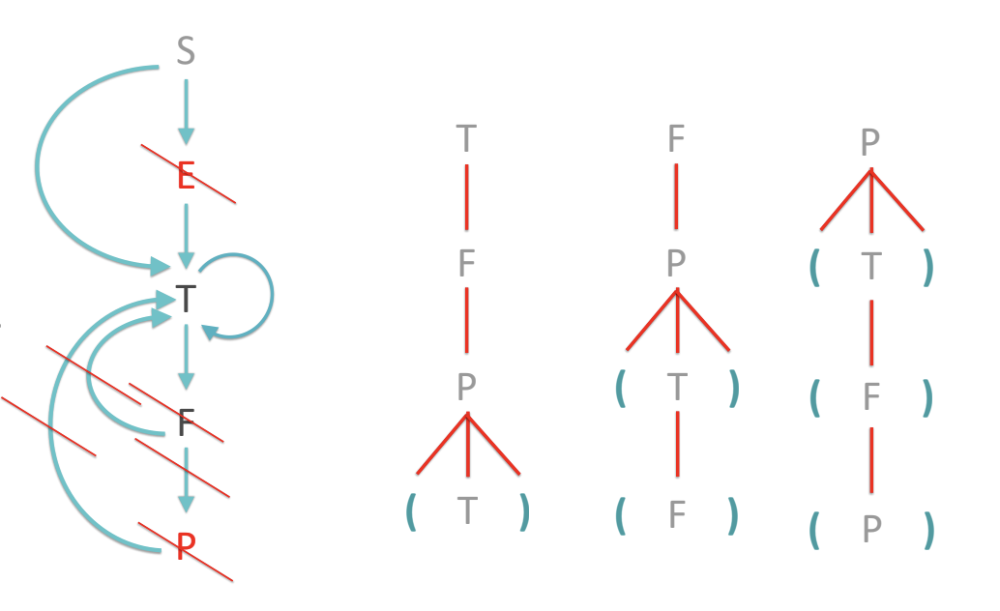

# Automato Bruto Etapa 1 - Simplificar e Reescrever a gramática formal

O processo de transformação de gramática formal em autômato gera apenas um autômato equivalente, que pode ser melhorado. O autômato gerado nesta primeira transformação (de gramática para autômato equivalente)
é chamado de autômato bruto. É então complementado por esta etapa de melhoria chamada de processo de obtenção de autômato ótimo.

## Processo de obtenção do Autômato Bruto

Nesse documento será detalhado a etapa 1 do processo de obtenção do autômato bruto, a simplificação e reescrita da gramática formal. 

### AB1.1 - Utilizar a notação mais simplificada
- Agrupar expressões que definem o mesmo não terminal
- Elimitar definições recursivas 

### AB1.2 Diminuir a quantidade de símbolos não terminais
- Determinar os não terminaos que podem ser eliminados
- Identificar não terminais auto recursivos 
- Identificar entre estes últimos os essenciais 

## Exemplo de gramática a ser traduzida

### PG
G=(V, Σ, X, S)
V={S, E, T, F, P, -, *, n, ( , ) }
Σ={-, *, n, ( , ) }

X = {S → E, E → ε, E → T, T → F, T → T - F, F → F * P, F → P, P → n, P → ( T ) }

### BNF
<S> ::= <E>
<E> ::= <T> | Ꜫ
<T> ::= <F> | <T> - <F>
<F> ::= <F> * 
 | 

 ::= n | ( <T> )

>[!note]
> T => T -F => T - F - F => T - F - F - F  => T - F - F - F - F
> F =: F * P => F * P * P => F * P * P * P

### Wirth
1. S = E.
2. E = [T].
3. T = F { “-” F} .
4. F = P {“*” P}.
5. P = “n” | “(“ T “)” .

### Simplifcação

#### Unindo a etapa 1 com a 2
(1,2). S = [ T ].

#### Unindo a etapa 4 com a 5
(4,5). F = (“n” | “(“ T “)”) { “*” (“n” | “(“ T “)”) } .

#### Unindo a etapa 3 com a (4,5)
(3,5,5). T = ((“n” | “(“ T “)”) { “*” (“n” | “(“ T “)”) } ) { “-” ((“n” | “(“ T “)”) { “*” (“n” | “(“ T “)”) } )} .

#### Unindo a etapa (1,2)com a (3,4,5)
(1,2,3,4,5). T = [ ((“n” | “(“ T “)”) { “*” (“n” | “(“ T “)”) } ) { “-” ((“n” | “(“ T “)”) { “*” (“n” | “(“ T “)”) } )} ] .

